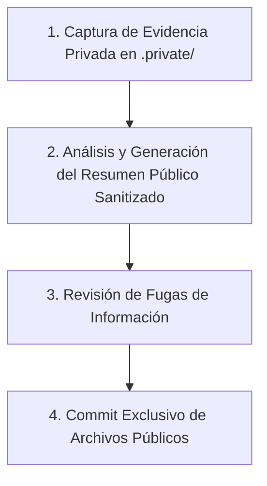

# Política de Clasificación y Frontera de Documentación (Pública/Privada)

Esta política establece las reglas estrictas sobre qué información puede ser almacenada en el repositorio público de Git y qué información debe mantenerse de forma estrictamente local y privada.

---

## 1. Clasificación de Información

### A. Qué DEBE ir en Git (Público)
Todo archivo en el repositorio público debe ser seguro para compartirse de forma abierta en GitHub. Esto incluye:
* **Planes y Roadmaps**: Hitos de desarrollo, requerimientos y metodologías de prueba.
* **Decisiones de Arquitectura (ADRs)**: Explicaciones sobre decisiones técnicas y de diseño.
* **Metodologías de Pruebas**: Instrucciones sobre cómo ejecutar tests, benchmarks y auditorías.
* **Resúmenes Sanitizados de Desempeño**: Estadísticas agregadas, tablas comparativas de benchmarks reproducibles y conclusiones generales de rendimiento.
* **Reportes Públicos de Cierre**: Reportes que siguen la plantilla pública sin incluir datos del entorno local de desarrollo.

### B. Qué NO DEBE ir en Git (Privado)
Toda información específica del entorno de desarrollo local o que pueda revelar secretos debe colocarse exclusivamente en `.private/` (o directorios `private/` locales) y nunca confirmarse en Git. Esto incluye:
* **Perfiles Crudos de Pprof (`.pprof`, `.prof`, `.trace`)**: Los perfiles contienen metadatos internos, nombres de usuario y rutas del sistema local (p. ej., `/Users/juan/...`) que exponen la estructura de directorios privada.
* **Dumps de Memoria y Trazas**: Volcados de fallos, trazas del planificador y salidas completas no filtradas de pprof.
* **Logs de Producción u Operaciones**: Datos de clientes, cabeceras HTTP reales, cookies o payloads de producción obtenidos en pruebas.
* **Secretos y Credenciales**: Claves API, tokens de autenticación, contraseñas, URLs de endpoints internos de infraestructura y certificados.
* **Evidencia No Sanitizada**: Información intermedia recopilada durante auditorías y pruebas que aún no ha sido revisada para su distribución pública.

---

## 2. Flujo de Trabajo Obligatorio

Cualquier cambio de rendimiento o auditoría debe seguir este proceso de tres pasos para prevenir fugas de información sensible en los commits públicos:

1. **Captura en Local (.private/)**: El desarrollador realiza la auditoría o la prueba y guarda toda la evidencia cruda (pprof, bench.out, logs crudos) bajo `.private/pprof/`, `.private/bench/` o `.private/evidence/`.
2. **Generación del Resumen Público**: A partir de la evidencia local, se redacta el reporte público de fase (p. ej., `docs/reports/phase-01-baseline-report.md`) usando números consolidados y omitiendo rutas absolutas, nombres de usuario e IPs locales.
3. **Revisión de Fugas**: Se ejecutan comandos de validación para asegurar que ningún archivo en `.private/` o bajo rutas locales privadas esté siendo trackeado.
4. **Commit Seguro**: Se confirman en Git únicamente los archivos de documentación pública modificados. Los perfiles locales y dumps permanecen indefinidamente en la máquina del desarrollador local sin ser commiteados.
