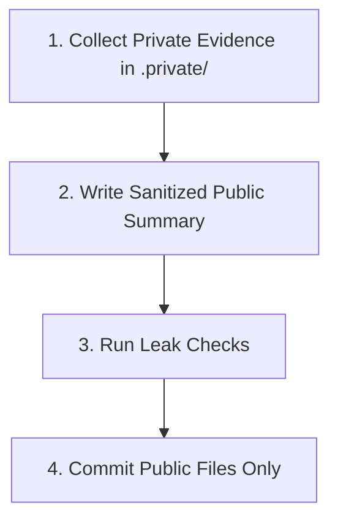

# Public and Private Documentation Policy

This policy defines rules on what technical information can be committed to the public Git repository, and what must remain local and private.

---

## 1. Information Classification

### A. What Belongs in Git (Public)
Any file in the public repository must be safe to share openly. This includes:
* **Roadmaps and Plans:** Milestones, requirements, and test plans.
* **Architecture Decision Records (ADRs):** Rationales behind design choices.
* **Testing Methods:** Setup steps to run unit tests, fuzz targets, and benchmarks.
* **Sanitized Performance Summaries:** Aggregate metrics, benchmark stats, and regression reviews.
* **Public Reports:** Sanitation reviews following the public template.

### B. What Must Not Be in Git (Private)
Any file specific to the local host environment or exposing private credentials must reside in `.private/` and never be committed. This includes:
* **Raw Profiling Outputs (`.pprof`, `.prof`, `.trace`):** Profiles contain internal usernames and local file systems paths (e.g. `/Users/...`).
* **Memory Dumps and Scheduler Traces:** Raw trace results and un-filtered pprof data.
* **Operational Logs:** Customer data, live HTTP payloads, or testing databases.
* **Secrets and Credentials:** API keys, access tokens, credentials, and internal hostnames.
* **Un-sanitized Work Outputs:** Intermediate audit logs collected before validation review.

---

## 2. Validation Workflow

Technical updates must follow this three-step process to prevent credentials leaks:

1. **Local Collection (`.private/`):** Run the validation suite and write raw logs, benchmarks, and profiles under `.private/pprof/`, `.private/bench/`, or `.private/evidence/`.
2. **Write Sanitized Summary:** Using the raw data, write a public summary report (e.g., `docs/reports/final-ssd-hard-validation-report.md`) omitting absolute paths, usernames, and local IP addresses.
3. **Leak Checks:** Run search commands to verify that no files in `.private/` or containing local absolute paths are staged.
4. **Commit:** Commit only the public documentation updates. Profiles and raw benchmarks remain locally on the host.
